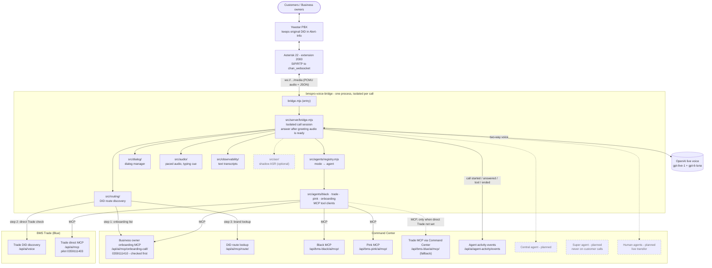
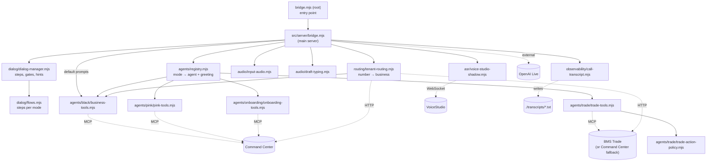
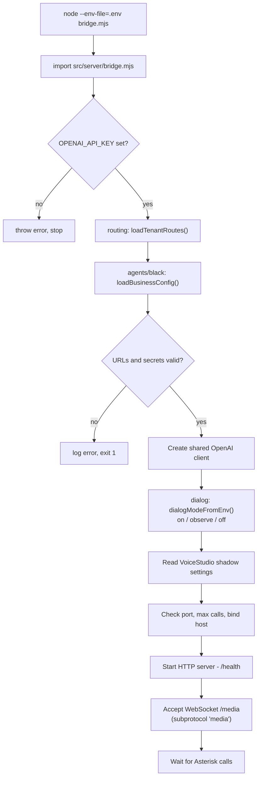
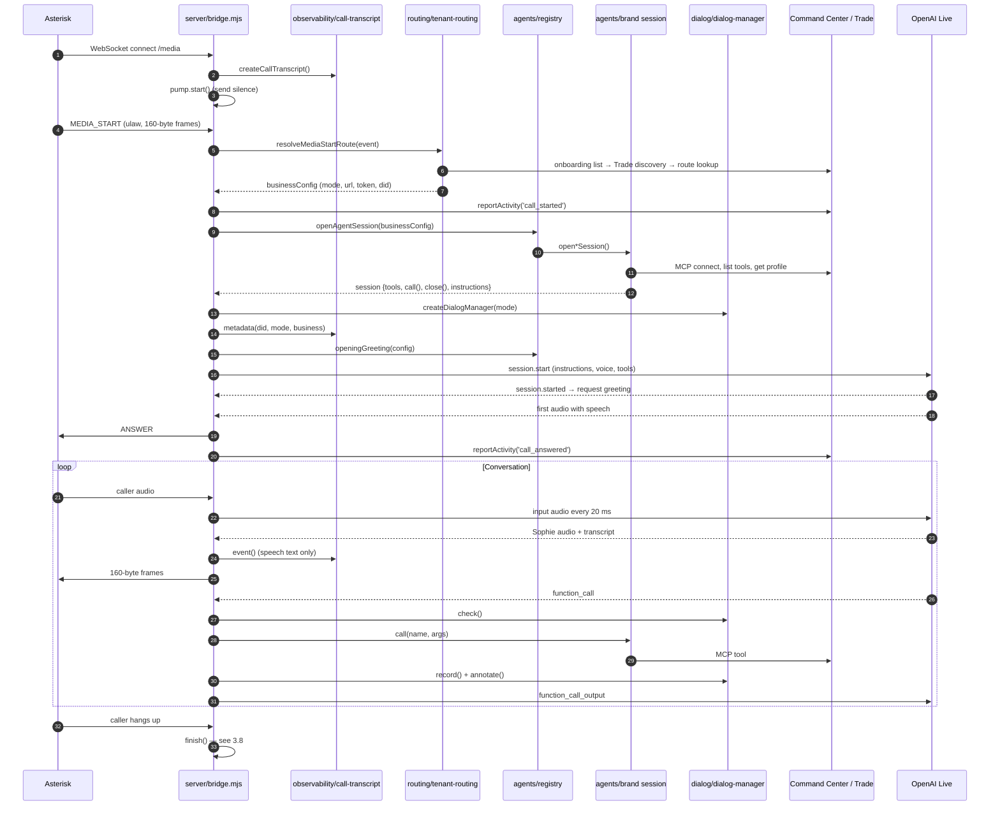
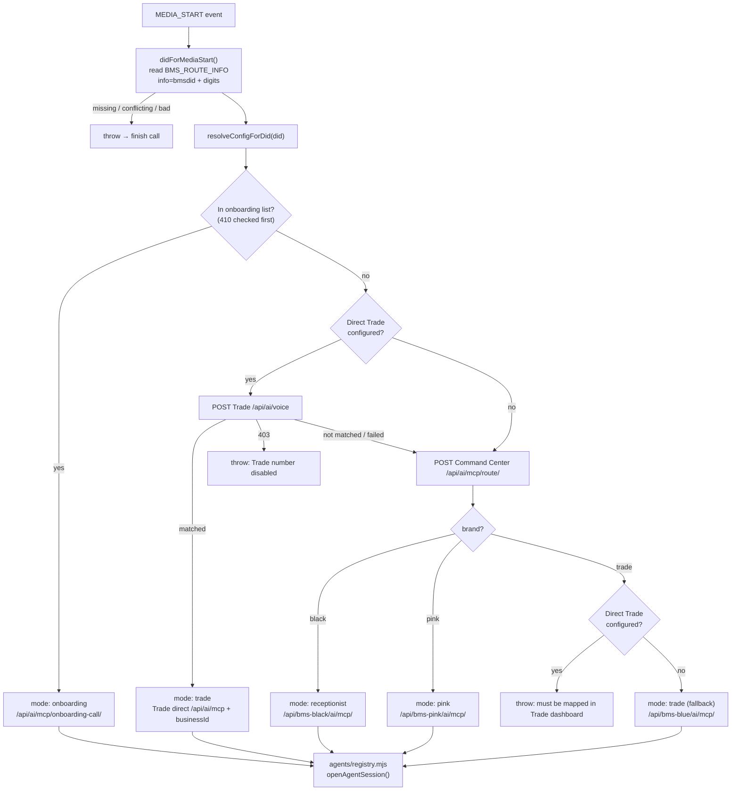
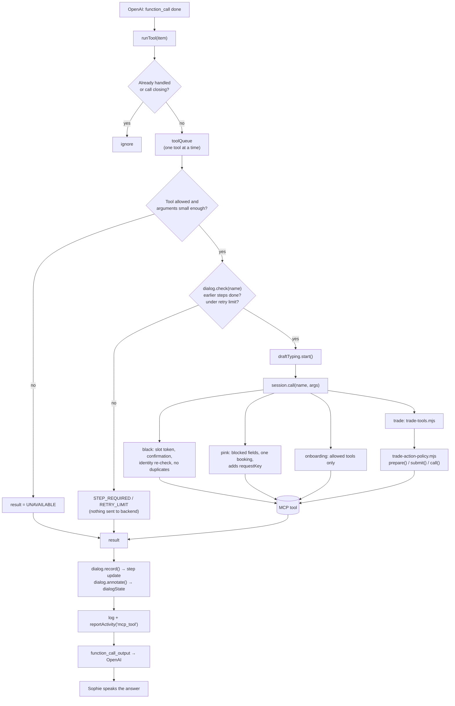
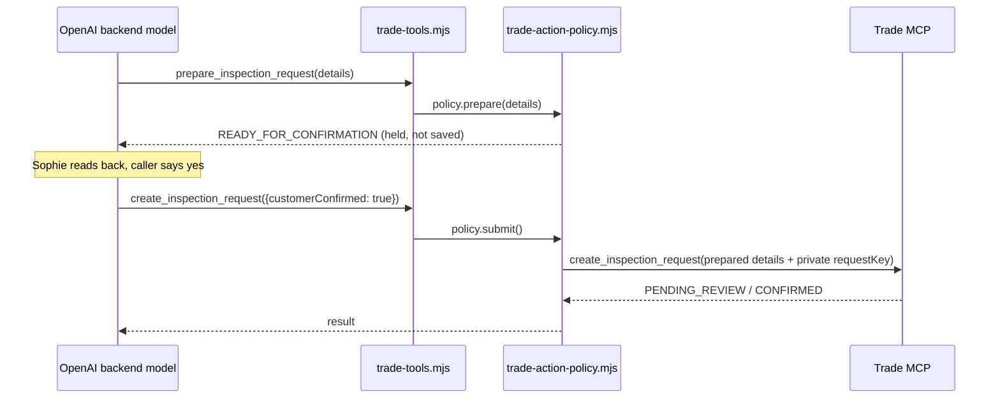
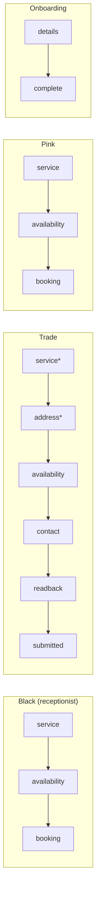
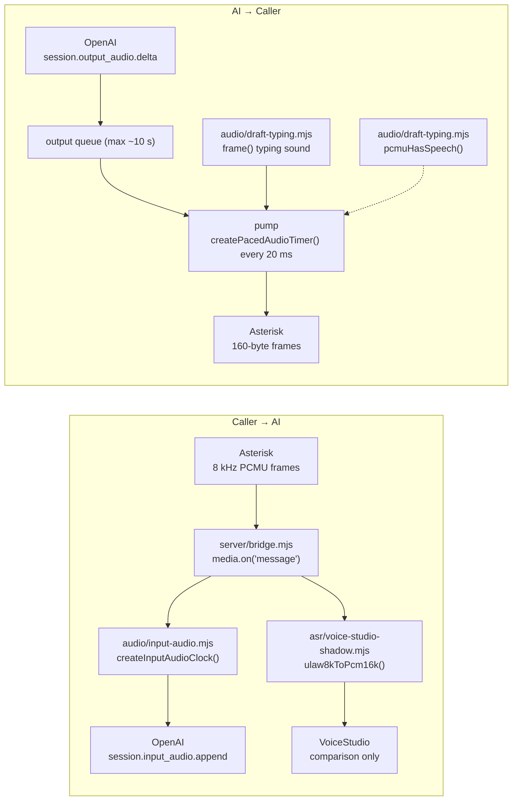
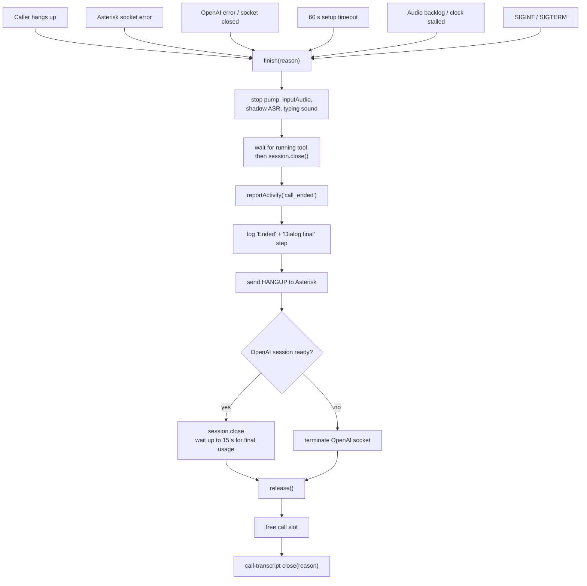

# Voice Bridge: Architecture, Folders, Functions and Call Flow

This page covers how the voice bridge fits the **BMS Pro Multi-Agent Architecture v4**, how its folders are organised, what every file and function does, and which file calls which during a phone call.

**Summary:** Asterisk (the phone system) streams call audio to the bridge over a WebSocket. For each call the bridge:
1. finds which business owns the dialled number,
2. opens that business's backend tools (MCP),
3. connects to OpenAI's live voice ("Sophie"),
4. tracks the conversation with the dialog manager,
5. plays Sophie's replies back to the caller.

One bridge process serves many businesses; tools and identity are isolated per call. The only file it writes is a per-call text transcript.

---

## 0. How to run (ports and commands)

### 0.1 Machines and ports

| Port | Runs on | What it is | Setting |
|---|---|---|---|
| **8787** | AI call center server (`dev@100.88.220.83`), `127.0.0.1` only | The voice bridge. Asterisk connects to `ws://127.0.0.1:8787/media`; health check at `http://127.0.0.1:8787/health` | `BMSPRO_PORT` (default 8787), `BMSPRO_BIND_HOST` (default 127.0.0.1) |
| **13001** | AI call center server, `127.0.0.1` only | Server end of the SSH reverse tunnel. Anything sent here goes to port 3001 on the Windows PC. | `BMSPRO_TRADE_MCP_URL=http://127.0.0.1:13001/api/ai/mcp` in `.env.trade-direct-pilot` |
| **3001** | Windows PC | Trade admin panel (Next.js): `/api/ai/mcp` (Trade MCP tools) and `/api/ai/voice` (DID discovery) | Start with `npx next dev --port 3001` |
| **22** (SSH) | AI call center server, reached over Tailscale at `100.88.220.83` | SSH login and the reverse tunnel | — |
| **3900** | AI call center server (optional) | VoiceStudio shadow speech-to-text, only when enabled | `BMSPRO_VOICESTUDIO_SHADOW_URL` |
| Extension **2000** | Asterisk (not a network port) | Dialplan entry that sends calls to the bridge | `deploy/asterisk/extensions.conf.example` |

> **Port check:** Trade's `npm run dev` starts on port **3002**, but the tunnel forwards to **3001**. Start Trade with `npx next dev --port 3001`, or change the tunnel to `...:127.0.0.1:3002`.

```
Caller → Yeastar PBX → Asterisk (ext 2000) → ws://127.0.0.1:8787/media → voice bridge
                                                                           │
          Windows PC: Trade on :3001  ◄── SSH reverse tunnel ◄── 127.0.0.1:13001 (server)
```

### 0.2 Start order (Trade direct pilot)

**Step 1 - Windows PC: start Trade on port 3001** (keep this terminal open)

```bash
cd C:\Users\syapa\OneDrive\Desktop\softdevglobal\projects\bmspro-trade-adminpanel\bmspro-trade-adminpanel
npx next dev --port 3001
```

**Step 2 - Windows PC: open the SSH reverse tunnel** (new terminal, keep it open)

```bash
ssh -N -o ExitOnForwardFailure=yes -o ServerAliveInterval=30 -R 127.0.0.1:13001:127.0.0.1:3001 dev@100.88.220.83
```

| Part | Meaning |
|---|---|
| `-N` | Don't open a shell; only keep the tunnel. |
| `-o ExitOnForwardFailure=yes` | Exit straight away if port 13001 can't be opened on the server (for example, an old tunnel is still running). |
| `-o ServerAliveInterval=30` | Send a keep-alive every 30 s so the tunnel doesn't drop when idle. |
| `-R 127.0.0.1:13001:127.0.0.1:3001` | On the server, listen on `127.0.0.1:13001` and forward to `127.0.0.1:3001` on this PC (Trade). |
| `dev@100.88.220.83` | The AI call center server over Tailscale. |

The terminal shows nothing while the tunnel is working. Closing it stops Trade calls.

**Step 3 - Server: log in and go to the bridge folder**

```bash
ssh dev@100.88.220.83
cd ~/bmspro-voice-bridge
```

**Step 4 - Server: check the Trade number before starting** (read-only; no OpenAI call, no booking)

```bash
node --env-file=.env --env-file=.env.trade-direct-pilot scripts/check-mcp.mjs 0359111403
```

Expected: the route is `mode=trade`, Nira Electrical Lynbrook's business is verified, services load, and seven tools are listed (four if Trade actions are disabled).

> If the server still has the **old flat layout** (before the `src/` folder change is uploaded), the script is at the root:
> `node --env-file=.env --env-file=.env.trade-direct-pilot check-mcp.mjs 0359111403`

**Step 5 - Server: start the bridge**

```bash
node --env-file=.env --env-file=.env.trade-direct-pilot bridge.mjs
```

Expected startup log:

```
Backend DID routing configured. Black, Pink, Trade and onboarding numbers use separate tools.
Dialog manager: on.
Audio pacing follows elapsed time; bounded catch-up enabled.
VoiceStudio shadow ASR disabled; OpenAI remains the live call path.
BMSPro voice pilot listening at ws://127.0.0.1:8787/media
```

**Step 6 - Server: confirm it's listening** (second SSH session)

```bash
curl http://127.0.0.1:8787/health
# {"status":"listening","activeCalls":0,"maxCalls":4,"routing":"backend-did-mappings"}
```

**Step 7 - Call the number** (0359111403 for the Trade pilot) and watch the logs and transcript:

```bash
cd ~/bmspro-voice-bridge
tail -f "$(ls -t transcripts/*.txt | head -n 1)"
```

**Stop:** press `Ctrl+C` in the bridge terminal. Active calls are ended cleanly and the process exits within 16 s.

### 0.3 Env files

| File | Used for | Main settings |
|---|---|---|
| `.env` | Always | `OPENAI_API_KEY`, `BMSPRO_MCP_URL`, `BMSPRO_BRIDGE_SECRET`, `BMSPRO_MAX_CONCURRENT_CALLS`, `BMSPRO_ONBOARDING_DIDS_JSON`, `BMSPRO_ONBOARDING_BRIDGE_SECRET`, optional `BMSPRO_DIALOG_MANAGER`, `BMSPRO_PORT` |
| `.env.trade-direct-pilot` | Trade direct pilot over the tunnel | `BMSPRO_TRADE_MCP_URL=http://127.0.0.1:13001/api/ai/mcp`, `BMSPRO_TRADE_BRIDGE_SECRET`, `BMSPRO_ALLOW_HTTP_FOR_LOCAL_TEST=true` |

Both files are passed with two `--env-file` flags. Never commit or upload secrets; `.gitignore` already excludes `.env` and `.env.*`.

### 0.4 Other useful commands (server, in `~/bmspro-voice-bridge`)

| Command | What it does |
|---|---|
| `node --env-file=.env scripts/check-mcp.mjs 0359111410` | Check the onboarding number (creates a setup draft; never approves or activates) |
| `node --env-file=.env scripts/check-mcp.mjs <black or pink DID>` | Check a Black or Pink number (read-only) |
| `node --env-file=.env.trade-direct-pilot scripts/diagnose-trade.mjs 0359111403` | Trade connection test: tunnel reachable? MCP initialises? Prints only status codes |
| `ls -lt transcripts/*.txt` | List call transcripts, newest first |
| `npm test` | Run all offline tests (no OpenAI, no network) |
| `npm ci` | Install dependencies after uploading a new `package-lock.json` |

### 0.5 Common problems

| Symptom | Likely cause | Fix |
|---|---|---|
| `ssh: ... remote port forwarding failed for listen port 13001` | An old tunnel is still holding port 13001 on the server | Close the old tunnel terminal, or on the server find it with `ss -ltnp \| grep 13001` and stop that ssh process |
| `check-mcp` / `diagnose-trade`: `FAILED code=ECONNREFUSED` | Tunnel is down, or Trade isn't running on 3001 | Restart Step 1 and Step 2; check the port is 3001, not 3002 |
| `Trade DID or business is disabled` | The number is turned off in the Trade dashboard DID mappings | Enable the mapping in Trade → DID mappings |
| `Cannot find module .../check-mcp.mjs` | Old command used on the new layout (or the other way round) | Use `scripts/check-mcp.mjs` on the new layout, `check-mcp.mjs` on the old one |
| Bridge exits: `BMSPRO_BIND_HOST must be loopback or ... Tailscale` | Wrong bind address | Leave `BMSPRO_BIND_HOST` unset (127.0.0.1) |

---

## Contents

0. [How to run (ports and commands)](#0-how-to-run-ports-and-commands)
1. [How the bridge fits Architecture v4](#1-how-the-bridge-fits-architecture-v4)
2. [Folder structure](#2-folder-structure)
3. [Diagrams](#3-diagrams)
   - [3.1 Which file imports which](#31-which-file-imports-which)
   - [3.2 Server startup](#32-server-startup)
   - [3.3 One phone call, start to finish](#33-one-phone-call-start-to-finish)
   - [3.4 Choosing the business (DID routing)](#34-choosing-the-business-did-routing)
   - [3.5 Running a tool](#35-running-a-tool)
   - [3.6 Dialog steps per mode](#36-dialog-steps-per-mode)
   - [3.7 Audio paths](#37-audio-paths)
   - [3.8 Ending a call](#38-ending-a-call)
4. [Function reference (every file)](#4-function-reference-every-file)
5. [What is written to disk](#5-what-is-written-to-disk)
6. [Where planned features will go](#6-where-planned-features-will-go)

---

## 1. How the bridge fits Architecture v4

### 1.1 Architecture diagram (bridge view)

Solid lines are live today. Dashed boxes are planned.



### 1.2 Architecture box → bridge folder

| Architecture v4 box | Where it is in the bridge | Status |
|---|---|---|
| Asterisk 22 - extension 2000 | `deploy/asterisk/` (dialplan + WebSocket client examples) | Current |
| bmspro-voice-bridge / bridge.mjs | `bridge.mjs` (entry) → `src/server/bridge.mjs` | Current |
| DID route discovery | `src/routing/tenant-routing.mjs` | Current |
| Isolated call session | `src/server/bridge.mjs` (one closure per call) + `src/dialog/` | Current |
| OpenAI live voice (external) | `src/server/bridge.mjs` (LiveWS connection) | Current |
| MCP tool client | `src/agents/<brand>/*-tools.mjs`, chosen by `src/agents/registry.mjs` | Current |
| Text transcripts | `src/observability/call-transcript.mjs` | Current |
| "Answer after greeting audio is ready" | `src/server/bridge.mjs` sends `ANSWER` on first audible speech | Current |
| Business owner onboarding (410 checked first) | `src/routing/` checks the onboarding list first; `src/agents/onboarding/` | Current |
| BMS Black - Workshops (Black MCP via Command Center) | `src/agents/black/business-tools.mjs` | Current (direct planned) |
| BMS Trade / Blue - Trade direct MCP | `src/agents/trade/` + direct Trade discovery in `src/routing/` | Current |
| BMS Pink - Salons (Pink MCP via Command Center) | `src/agents/pink/pink-tools.mjs` | Current (direct planned) |
| Workshop / Trade / Salon A, B "own agent profile, isolated voice session" | One agent file per brand serves every business. Identity comes from the DID and is verified per call. | Current |
| Central agent, Human agents | Not in the bridge yet (see [section 6](#6-where-planned-features-will-go)) | Planned |
| Super agent, Super RAG, Own RAG, Agent link / A2A | Backend side (Command Center / product backends), not in the bridge | Planned |

### 1.3 Differences found and what was changed

| # | Finding | Action |
|---|---|---|
| 1 | The architecture shows a single `bridge.mjs`. The code now has a 4-line entry `bridge.mjs` and the real bridge in `src/server/bridge.mjs`. | Documented. The start command `node --env-file=.env bridge.mjs` is unchanged. |
| 2 | The error message in `scripts/check-mcp.mjs` still said `check-mcp.mjs` (old root path). | **Fixed** to `scripts/check-mcp.mjs`. |
| 3 | The architecture shows only **Trade direct MCP**. The code also keeps a fallback: if `BMSPRO_TRADE_MCP_URL` is not set, Trade calls go through Command Center `/api/bms-blue/ai/mcp/`. | Not an error. Shown as a dashed line in 1.1. Once direct Trade is live everywhere, the fallback can be removed. |
| 4 | The architecture doesn't show that the bridge reports call activity to Command Center (`/api/ai/agent-activity/events`), including for Trade direct calls. | Added to diagram 1.1. This is today's "reports up". A2A will extend it later. |
| 5 | The new dialog manager isn't in the architecture picture. | It belongs inside **Isolated call session** (per call, never shared). Added to 1.1. Suggest adding it to the next architecture version. |
| 6 | Planned items (central agent, human transfer, direct Black/Pink) have no place in the code yet. | No empty folders were created. [Section 6](#6-where-planned-features-will-go) lists where each will go. |

No folder changes were needed: every current architecture box maps to exactly one bridge folder.

---

## 2. Folder structure

```
bmspro-voice-bridge/
├─ bridge.mjs                         Entry point only. Starts src/server/bridge.mjs.
├─ package.json                       npm start / npm test / npm run check-mcp
├─ package-lock.json
├─ README.md                          Layout, deploy steps, dialog manager settings, setup notes
├─ .env.example                       Settings template (real .env files are never committed)
├─ .gitignore                         Keeps node_modules, .env files, transcripts, audio and logs out of git
│
├─ src/
│  ├─ server/
│  │  └─ bridge.mjs                   HTTP /health, Asterisk WebSocket, per-call orchestration
│  ├─ routing/
│  │  └─ tenant-routing.mjs           DID → onboarding / Trade direct / Black / Pink / Trade
│  ├─ agents/
│  │  ├─ registry.mjs                 Mode → agent session + opening greeting
│  │  ├─ black/business-tools.mjs     BMS Black workshop receptionist (MCP client)
│  │  ├─ trade/trade-tools.mjs        BMS Trade inspections and advice (MCP client)
│  │  ├─ trade/trade-action-policy.mjs  Trade per-call safety rules
│  │  ├─ pink/pink-tools.mjs          BMS Pink salon receptionist (MCP client)
│  │  └─ onboarding/onboarding-tools.mjs  Business owner sign-up (MCP client)
│  ├─ dialog/
│  │  ├─ dialog-manager.mjs           Per-call steps, write gates, retry limit, hints
│  │  └─ flows.mjs                    Step definitions for each mode
│  ├─ audio/
│  │  ├─ input-audio.mjs              20 ms paced audio timers
│  │  └─ draft-typing.mjs             Typing sound + speech detection (PCMU)
│  ├─ asr/
│  │  └─ voice-studio-shadow.mjs      Optional comparison speech-to-text
│  └─ observability/
│     └─ call-transcript.mjs          Per-call transcript .txt files
│
├─ tests/                             node --test suites (run: npm test)
├─ scripts/
│  ├─ check-mcp.mjs                   Check a DID's route and MCP tools (no OpenAI)
│  └─ diagnose-trade.mjs              Read-only Trade network/MCP diagnostic
├─ deploy/
│  └─ asterisk/
│     ├─ extensions.conf.example      Dialplan for extension 2000
│     └─ websocket_client.conf.example  Where Asterisk connects (ws://127.0.0.1:8787/media)
└─ docs/
   ├─ FUNCTIONS_AND_FLOW.md           This page
   ├─ MULTI_WORKSHOP_SETUP.md         Black multi-workshop setup (older single-file paths)
   ├─ ONBOARDING_SETUP.md             Onboarding setup (older single-file paths)
   ├─ PINK_SETUP.md                   Pink setup (older single-file paths)
   └─ TRADE_SETUP.md                  Trade setup (older single-file paths)
```

**Rules for this layout:**
- `src/server/` runs calls. It never contains brand-specific logic.
- `src/agents/<brand>/` holds everything specific to one product: tools, prompts and safety rules. A new product gets a new folder plus one line in `registry.mjs`.
- `src/dialog/` holds conversation steps. Business data stays in the backend; the dialog manager only tracks progress.
- `src/routing/` decides **which** agent handles a call; `src/agents/` decides **how**.
- Nothing in `src/` writes files except `src/observability/`.

---

## 3. Diagrams

### 3.1 Which file imports which



`tenant-routing.mjs` reuses `loadBusinessConfig()` from `business-tools.mjs` to check the Command Center URL and secret.

---

### 3.2 Server startup



---

### 3.3 One phone call, start to finish



---

### 3.4 Choosing the business (DID routing)



---

### 3.5 Running a tool



Trade's two-step inspection booking:



---

### 3.6 Dialog steps per mode



`*` optional: counts as passed once a later step is done. Gates (write tools blocked until these steps are done):

| Mode | Write tool | Needs |
|---|---|---|
| Black | `create_booking` | availability |
| Trade | `prepare_inspection_request` | availability |
| Trade | `create_inspection_request` | readback |
| Pink | `create_booking` | service, availability |
| Onboarding | `complete_business_onboarding` | details |

---

### 3.7 Audio paths



- Before Sophie speaks, the pump sends silence so the phone line's return audio path is established.
- `ANSWER` is sent only when the first audio with speech arrives, so the caller hears ringing until Sophie is ready.
- Playback starts 400 ms after answer so the start of the greeting isn't cut off.

---

### 3.8 Ending a call



---

## 4. Function reference (every file)

### [bridge.mjs](../bridge.mjs) (root entry)

| Code | What it does |
|---|---|
| `import './src/server/bridge.mjs'` | Starts the bridge. Kept at the root so `node --env-file=.env bridge.mjs` and existing service scripts keep working. |

---

### [src/server/bridge.mjs](../src/server/bridge.mjs)

The main server: startup, HTTP and WebSocket servers, and everything that happens during a call. It contains no brand-specific logic.

**Startup (runs once)**

| Code | What it does |
|---|---|
| Startup checks | Stops if `OPENAI_API_KEY` is missing. Calls `loadTenantRoutes()`, exits if routing config is invalid. |
| `client` | One OpenAI client shared by all calls. |
| `dialogMode` | Reads `BMSPRO_DIALOG_MANAGER` (`on` / `observe` / `off`) and logs it. |
| `voiceStudioShadowEnabled` / `voiceStudioShadowDids` | Turns comparison speech-to-text on for numbers in `BMSPRO_VOICESTUDIO_SHADOW_DIDS_JSON`. |
| `maxCalls`, `port` | Max concurrent calls (`BMSPRO_MAX_CONCURRENT_CALLS`, 1–32, default 4) and port (`BMSPRO_PORT`, default 8787). |
| `bindHost`, `bindOctets`, `bindIsLoopback`, `bindIsTailscale` | Listening address (`BMSPRO_BIND_HOST`, default 127.0.0.1). Must be loopback or a Tailscale IPv4 (100.64.0.0–100.127.255.255), otherwise startup stops. |
| `activeCalls`, `stopCalls`, `shuttingDown` | Open calls, a stop function per call, and whether shutdown has started. |
| `server` | HTTP server. `/health` returns status and the active call count; everything else returns 404. |
| `server.on('upgrade')` | Accepts the Asterisk WebSocket on `/media`; returns 503 when full or shutting down. |
| SIGINT / SIGTERM | Ends every call, closes the server, exits within 16 s. |

**Per call (one WebSocket is one call)**

| Function | What it does |
|---|---|
| `log(message)` | Log line with a timestamp and a short call ID. |
| `safeCode(value)` | Strips a value to safe characters for logs. |
| `safeDiagnostic(value)` | Cleans error text; hides emails, phone numbers and tokens. |
| `reportActivity(eventType, values)` | Sends call events to Command Center `/api/ai/agent-activity/events` without waiting (4 s timeout, errors ignored). |
| `safeTokenUsage(value)` / `usageFromEvent(event)` | Keep only token counts from OpenAI usage data. |
| ↳ `walk(source, target, depth)` | Inside `safeTokenUsage`: walks nested usage objects (max 4 levels) and copies only numeric `token` fields. |
| `command(name)` | Sends `ANSWER` or `HANGUP` to Asterisk. |
| `release()` | Final cleanup: frees the call slot, closes the transcript. |
| `finish(reason)` | Ends the call cleanly and logs the final dialog step (see 3.8). |
| `inputAudio` | Caller-audio sender (`createInputAudioClock()`). |
| `setupTimer` | Ends the call if setup takes over 60 s. |
| `dialog` | This call's dialog manager, created after the agent session opens. |
| `runTool(item)` | Runs a tool the AI asked for, with dialog check, record and annotate (see 3.5). |
| `handledCalls`, `toolQueue` | Tool request IDs already run (so the same request never runs twice), and the queue that runs tools one at a time. |
| `pump` | 20 ms output timer: Sophie's audio, typing sound or silence to Asterisk. |
| `media.on('message')` | Asterisk audio and events. `MEDIA_START` sets up the call; `MEDIA_XOFF` / `MEDIA_XON` pause and resume output. |
| `live.socket.on('open')` | Sends `session.start`: model, voice `shimmer`, PCMU 8 kHz, instructions, date and time, tools, and dialog instructions when on. |
| `live.on('event')` | OpenAI events: transcript, usage, typing sound, tool calls, greeting, audio, answering the call. |
| `media.on('error' / 'close')`, `live.socket.on('close')` | Call `finish()`. |

---

### [src/routing/tenant-routing.mjs](../src/routing/tenant-routing.mjs)

DID route discovery: which business and which agent handle the dialled number.

| Function | What it does |
|---|---|
| `loadTenantRoutes(env)` | Startup. Checks `BMSPRO_BRIDGE_SECRET`. Builds the Command Center URLs (Black, Pink, Trade fallback, route lookup), the optional direct Trade setup (`BMSPRO_TRADE_MCP_URL` with its own secret), and the onboarding number list (`BMSPRO_ONBOARDING_DIDS_JSON` with its own secret). |
| `didForMediaStart(event)` | Reads the number from Asterisk's `BMS_ROUTE_INFO` (`<...>;info=bmsdid<digits>`). |
| `configForDid(did, routes, brand)` | Builds the call config (mode, url, token, routing headers) for a number and brand. |
| `resolveConfigForDid(did, routes)` | Order: onboarding list, then direct Trade discovery, then Command Center route lookup (see 3.4). |
| `resolveMediaStartRoute(event, routes)` | `didForMediaStart` then `resolveConfigForDid`. Called by the server. |

---

### [src/agents/registry.mjs](../src/agents/registry.mjs)

Maps a call mode to its agent.

| Function | What it does |
|---|---|
| `AGENT_MODES` | `receptionist` (Black), `trade`, `pink`, `onboarding`. |
| `openAgentSession(config, timing)` | Opens the right session: onboarding, Trade, Pink, or Black (default). |
| `openingGreeting(config)` | The fixed Sophie greeting for each mode. |
| `greetingRules` | Shared ending for every greeting: pronounce Sophie as SOH-fee, pause and listen, no tool before greeting. |
| `speak(sentence)` | Wraps a greeting sentence in the "Speak this greeting in English..." instruction plus `greetingRules`. |

---

### [src/agents/black/business-tools.mjs](../src/agents/black/business-tools.mjs)

BMS Black workshop receptionist (Black MCP via Command Center).

| Function | What it does |
|---|---|
| `READ_TOOLS`, `VOICE_TOOLS` | `get_workshop_profile`, `list_services`, `get_available_slots`, plus `create_booking`. |
| `normalize(value)` | Lowercase and trim for name comparison. |
| `loadBusinessConfig(env)` | Checks `BMSPRO_MCP_URL` (production HTTPS, or local/Tailscale HTTP for testing) and `BMSPRO_MCP_SECRET` (32+ characters). |
| `readResult(result, label)` | Tool result to JSON; throws on error. |
| `assertIdentity(value, config)` | Checks the backend answered for the right workshop, branch and number. |
| `openBusinessSession(config, opts)` | Connects, loads tools and profile, checks identity, returns the session. Explains HTTP failures (401 / 403 / 404 / 429). |
| ↳ `timed(phase, op)` | Times a setup step for the logs. |
| ↳ `loadInventory()` | Pages through the tool list (max 200). |
| ↳ `close()` | Ends the backend session. |
| ↳ `call(name, args)` | Runs a tool. `create_booking` needs an offered, unexpired `slotToken`, `customerConfirmed: true`, and a valid name, email and phone; it re-checks identity and blocks duplicates. After an uncertain result it refuses further bookings. |
| `checkBusinessTools(config)` | Readiness check; returns the service count. |
| `voiceInstructions(config)` | Prompt for the voice model (also the default for all modes). |
| `backendInstructions(config)` | Prompt for the backend model (also the default). |

---

### [src/agents/trade/trade-tools.mjs](../src/agents/trade/trade-tools.mjs)

BMS Trade (Blue) inspections and advice. Uses the Trade direct MCP, or the Command Center fallback.

| Function | What it does |
|---|---|
| `TRADE_READ_TOOLS` | Required: `get_business_profile`, `list_services`. |
| `turnInstructions`, `conversationGuide` | Prompt text: Australian accent, one question at a time, check dates as soon as given. |
| `decode(result)` | Tool result to JSON. |
| `openTradeSession(config, opts)` | Connects with the DID and locked business ID on every request, checks the profile (brand, DID, businessId, timezone), builds the session. Error codes look like `TRADE_HTTP_403`. |
| ↳ `close()`, `timed()` | Same as Black. |
| ↳ `tools` | Hides `requestKey`; splits `create_inspection_request` into `prepare_inspection_request` and `create_inspection_request({customerConfirmed: true})`. |
| ↳ `call(name, args)` | Passes to `trade-action-policy.mjs` (`prepare`, `submit`, `call`). |

---

### [src/agents/trade/trade-action-policy.mjs](../src/agents/trade/trade-action-policy.mjs)

Trade per-call safety rules.

| Function | What it does |
|---|---|
| `baseTools`, `writeTools` | Always-on read tools (`get_business_profile`, `list_services`) and save tools (`register_customer`, `create_inspection_request`). |
| `canonical`, `object`, `only`, `id`, `date` | Small checks: sorted JSON, plain object, allowed keys only, safe ID, ISO date. |
| `rejected(message)`, `unknown()` | Standard `REJECTED` / `UNKNOWN` results. |
| `contact(value, full)` / `contactKey` | Check and normalise customer name, email and phone. |
| `createTradeActionPolicy(inventory, remote)` | Builds the policy; tools are enabled only when the tools they depend on exist. |
| ↳ `prepare(raw)` | Checks and holds inspection details before the readback (`READY_FOR_CONFIRMATION`). |
| ↳ `submit(raw)` | Sends the held details after the caller confirms. |
| ↳ `call(name, raw)` | Checks arguments for each tool. It blocks `businessId`/`requestKey`/`status`, limits date ranges to 1–90 days, only allows services listed in this call, reports which contact fields are invalid, and adds a private retry key. |

---

### [src/agents/pink/pink-tools.mjs](../src/agents/pink/pink-tools.mjs)

BMS Pink salon receptionist (Pink MCP via Command Center).

| Function | What it does |
|---|---|
| `PINK_READ_TOOLS` | `get_business_profile`, `list_services`, `get_available_slots`; `create_booking` if offered. |
| `writeTool` | The one save tool: `create_booking`. |
| `canonical(value)` | Sorted-key JSON, used to detect an identical repeat booking. |
| `decode(result)` | Tool result to JSON. |
| `openPinkSession(config, opts)` | Connects, checks the profile (brand pink, DID, owner, branch, timezone), builds the session. |
| ↳ `close()`, `timed()` | Same as above. |
| ↳ `call(name, args)` | Blocks `ownerUid`/`branchId`/`businessId`/`requestKey`. Availability needs one service from this call. Booking needs confirmation and a slot token from this call. One booking per call; adds a `requestKey`. |

---

### [src/agents/onboarding/onboarding-tools.mjs](../src/agents/onboarding/onboarding-tools.mjs)

Business owner sign-up (Command Center onboarding MCP, number 0359111410).

| Function | What it does |
|---|---|
| `ONBOARDING_TOOLS` | `save_onboarding_draft`, `get_onboarding_status`, `complete_business_onboarding`, plus plan tools if available. |
| `planTools` | Optional plan-listing tools for Black, Trade and Pink; enabled only if the backend offers them. |
| `profileUri` | `bmspro://onboarding/call`, the MCP resource holding the backend's prompts and greeting for this call. |
| `turnInstructions`, `conversationGuide` | Prompt text: save each answer right away, clarify unclear details, form fields for each product. |
| `decode(result)` | Result to JSON; backend errors become `REJECTED`. |
| `openOnboardingSession(config)` | Creates a sign-up call ID (header), giving one draft per call. Loads tools, reads `bmspro://onboarding/call` (prompts and greeting), checks the DID, loads draft status. Timeouts up to 120 s. |
| ↳ `close()` | Ends the session. |
| ↳ `call(name, args)` | Allowed tools only. On failure it tells the AI to check status before retrying. |

---

### [src/dialog/flows.mjs](../src/dialog/flows.mjs)

| Export | What it does |
|---|---|
| `FAILED_STATUSES` | Statuses that don't count as progress (`REJECTED`, `UNAVAILABLE`, `UNKNOWN`, `CONFIRMATION_REQUIRED`, ...). |
| `WRITE_TOOLS` | Tools that save: `create_booking`, `create_inspection_request`, `register_customer`, `complete_business_onboarding`. |
| `hasSlots(result)` | Success check: true only when `get_available_slots` returned at least one slot (Black and Pink). |
| `FLOWS` | Steps, gates and success checks for each mode (see 3.6). For example, Black slots only count if at least one slot was returned. |

### [src/dialog/dialog-manager.mjs](../src/dialog/dialog-manager.mjs)

| Function | What it does |
|---|---|
| `DIALOG_MODES` | Allowed settings: `on`, `observe`, `off`. |
| `MAX_WRITE_FAILURES` | 3: failed save attempts in a row before `RETRY_LIMIT`. |
| `dialogModeFromEnv(env)` | Reads `BMSPRO_DIALOG_MANAGER`; rejects values other than `on`, `observe`, `off`. |
| `succeeded(flow, name, result)` | Whether a tool result moved the conversation forward. |
| `createDialogManager({mode, enforce, log})` | Creates the per-call manager below. |
| ↳ `isDone(step)` | Internal: true when one of the step's `doneBy` tools has succeeded in this call. |
| ↳ `status()` | Internal: works out the current step and completed steps, treating optional steps as passed once a later step is done. |
| ↳ `snapshot()` | Current step (or `done`), completed steps, next hint, tool-call count. |
| ↳ `check(name)` | Before a tool runs. `STEP_REQUIRED` if a gated step is missing; `RETRY_LIMIT` after 3 failed writes in a row; otherwise `null`. In `observe` mode it only logs "would block". |
| ↳ `record(name, result)` | After a tool runs. Marks progress, counts failed writes (any progress resets the count), logs `Dialog: step a -> b`. |
| ↳ `annotate(result)` | Adds `dialogState: {step, completed, next}` to object results the AI reads (arrays unchanged). |
| `DIALOG_INSTRUCTIONS` | Extra backend-model instruction explaining `dialogState` and `STEP_REQUIRED`. |

The gates repeat rules the sessions and backend already enforce, so they never allow anything new; they stop earlier with a clearer next step.

---

### [src/audio/input-audio.mjs](../src/audio/input-audio.mjs)

| Function | What it does |
|---|---|
| `createPacedAudioTimer({tick, onError})` | Calls `tick()` every 20 ms based on real elapsed time. Catches up by up to 5 frames at a time; errors if more than 8 s behind. Returns `start()`, `stop()`. |
| ↳ `pump()` | Internal: works out how many 20 ms frames are due and calls `tick()` for each (max 5 per run). |
| ↳ `stop()` | Stops the interval timer. |
| `createInputAudioClock({send, canSend, onError})` | Queues caller audio and sends 160-byte frames to OpenAI, filling gaps with silence. Errors past 64 KB of backlog. Returns `start()`, `append()`, `stop()`. |
| ↳ `tick()` | Internal: builds one 160-byte frame (queued audio, padded with silence `0xFF`) and sends it, if `canSend()` allows. |
| ↳ `fail(code, bufferedBytes)` | Internal: stops the clock and reports `INPUT_AUDIO_SEND_FAILED`, `INPUT_AUDIO_BACKLOG` or `INPUT_AUDIO_CLOCK_STALLED`. |
| ↳ `append(data)` / `stop()` | Add caller audio to the queue / stop and clear the queue. |

### [src/audio/draft-typing.mjs](../src/audio/draft-typing.mjs)

| Function | What it does |
|---|---|
| `muLaw(sample)` | Converts a sample to PCMU (μ-law). |
| `pcmuHasSpeech(frame)` | Uses loudness to tell speech from silence. |
| `sound`, `taps` *(top-level code)* | Generates a 1.6 s keyboard-and-mouse sound (`sound`, 12,800 bytes) once at startup; `taps` are the keystroke positions. |
| `createDraftTypingCue()` | Returns `start()`, `stop()`, `frame(canPlay)`. Waits 150 ms before playing and stops after 45 s. |

---

### [src/asr/voice-studio-shadow.mjs](../src/asr/voice-studio-shadow.mjs)

Optional comparison speech-to-text. Never affects the live call.

| Function | What it does |
|---|---|
| `MAX_PENDING_ULAW_BYTES`, `MAX_WS_BUFFERED_BYTES` | Limits: hold at most 1 s of audio while connecting; drop audio if VoiceStudio's send buffer is over 256 KB. |
| `ulawSampleToPcm16(byte)` | Decodes one μ-law byte. |
| `ulaw8kToPcm16k(input)` | 8 kHz μ-law to 16 kHz 16-bit PCM. |
| `safeCode(value)` | Safe characters for logs. |
| `createVoiceStudioShadow({...})` | Connects to VoiceStudio (secure `wss:` or local `ws:` only). Holds 1 s of audio while connecting. Logs final transcripts (character count only unless `logTranscripts` is on). Returns `append()`, `end()`. |
| ↳ `report`, `cleanup`, `fail`, `sendAudio` | Logging, clearing timers, error handling, sending audio. |

---

### [src/observability/call-transcript.mjs](../src/observability/call-transcript.mjs)

The only module that writes files.

| Function | What it does |
|---|---|
| `speakers` | Maps OpenAI transcript events to `Caller` (input) and `Sophie` (output). |
| `stamp(ms)` | Formats time as `mm:ss.sss`. |
| `createCallTranscript({callId, directory})` | Creates the folder and a new file, then writes a header. |
| ↳ `metadata({...})` | Adds a `Route:` line. |
| ↳ `event(event)` | Adds caller and Sophie speech with timestamps; skips duplicates. |
| ↳ `close(reason)` | Writes the end time and reason, closes the file. |
| ↳ `flush()` | Waits for pending writes. |
| ↳ `append(text)` | Internal: queues a write so lines are written in order. |
| ↳ `fail()` | Reports one write failure and stops writing; the call continues. |

---

### [scripts/check-mcp.mjs](../scripts/check-mcp.mjs)

`node --env-file=.env scripts/check-mcp.mjs <DID>`. A readiness check that never calls OpenAI.

| Step | What it does |
|---|---|
| Route | `loadTenantRoutes()` + `resolveConfigForDid(did)`; prints the mode and endpoint. |
| Onboarding | Opens and closes an onboarding session. This creates a setup draft but never approves or activates. |
| Trade / Pink | Opens the session and runs `list_services`; prints the service count and enabled tools (read-only). |
| Black | `checkBusinessTools()`; prints the service count and enabled tools. |

### [scripts/diagnose-trade.mjs](../scripts/diagnose-trade.mjs)

`node --env-file=.env.trade-direct-pilot scripts/diagnose-trade.mjs <DID>`. A read-only Trade direct connection check that never prints secrets or response bodies.

| Function | What it does |
|---|---|
| `code(value)` | Safe error code for output. |
| `check(label, init)` | Sends one request with a 30 s timeout and prints the HTTP status and duration. On network failure it suggests Tailscale, port 3001 or firewall checks. |
| `url`, `secret`, `did` | Trade MCP URL (`BMSPRO_TRADE_MCP_URL`, default `http://127.0.0.1:3001/api/ai/mcp`), bridge secret (`BMSPRO_TRADE_BRIDGE_SECRET`), and the DID argument. |
| `reachability` *(script)* | 1) Network GET to the Trade MCP URL. 2) If reachable, MCP `initialize` with the DID header; prints whether it initialised. |

---

### [tests/](../tests)

Run all with `npm test`. All are offline; no OpenAI calls.

| File | Covers |
|---|---|
| `call-transcript.test.mjs` | Transcript file format, speaker lines, unsafe call IDs. |
| `direct-trade.test.mjs` | Trade direct discovery and routing rules. |
| `draft-typing.test.mjs` | Typing sound and speech detection. |
| `input-audio.test.mjs` | Audio pacing, catch-up and backlog limits. |
| `onboarding.test.mjs` | Onboarding routing, separate call identities, tool exposure. |
| `pink.test.mjs` | Pink identity, services, slots, single booking. |
| `startup.test.mjs` | Black and onboarding session startup and tenant checks. |
| `trade-action-policy.test.mjs` | Trade prepare/submit, consent, retries, availability gates. |
| `trade.test.mjs` | Trade session over a real MCP server, pinned business. |
| `dialog-manager.test.mjs` | Dialog steps, gates, retry limit, observe mode, greetings unchanged. |

---

### [deploy/asterisk/](../deploy/asterisk)

| File | What it does |
|---|---|
| `extensions.conf.example` | Extension 2000: saves `Alert-Info` as `BMS_ROUTE_INFO` (rejects if missing), plays ringing, dials `WebSocket/bmspro-media` with ulaw + JSON, and doesn't answer (the bridge answers). |
| `websocket_client.conf.example` | Connection `bmspro-media` → `ws://127.0.0.1:8787/media`, subprotocol `media`, one connection per call, no reconnect. |

---

## 5. What is written to disk

| What | Where | Details |
|---|---|---|
| Call transcript | `BMSPRO_TRANSCRIPTS_DIR` (default `./transcripts`) | One file per call: `<start-time>_<callId>.txt`. Folder mode 700, file mode 600, never overwritten. Turn off with `BMSPRO_TRANSCRIPTS_ENABLED=false`. |

Each transcript contains:
- a header
- the route (DID, mode, business)
- timestamped `Caller:` / `Sophie:` lines
- the end time and reason

Audio, tool data, credentials and full event data are never written.

---

## 6. Where planned features will go

Nothing below exists yet; this is where each piece should be added so the layout stays consistent with Architecture v4.

| Planned (Architecture v4) | Bridge change | Location |
|---|---|---|
| Direct Black MCP / direct Pink MCP | New endpoint and secret settings, the same way direct Trade works today. | `src/routing/tenant-routing.mjs` only; agents unchanged. |
| Central agent (central-line directory and handover) | New mode and agent, plus a route for the central number. | `src/agents/central/` + a line in `src/agents/registry.mjs` + `src/dialog/flows.mjs`. |
| Human agents (live transfer) | A transfer tool, and an Asterisk transfer command instead of `HANGUP`. | Transfer logic in `src/telephony/` (new), called from `src/server/bridge.mjs`. Dialplan in `deploy/asterisk/`. |
| Own RAG per business, Super RAG | None in the bridge. Knowledge is served by the product backend / Command Center as MCP tools. | Backend. The agent just gets a new tool. |
| Super agent | None. It never joins customer calls. | Command Center. |
| Agent link / A2A (reports up, tasks down) | Today's `reportActivity` events are the "reports up" part. Richer reports would move to a module. | `src/observability/agent-activity.mjs` (new), moved out of `src/server/bridge.mjs`. |
