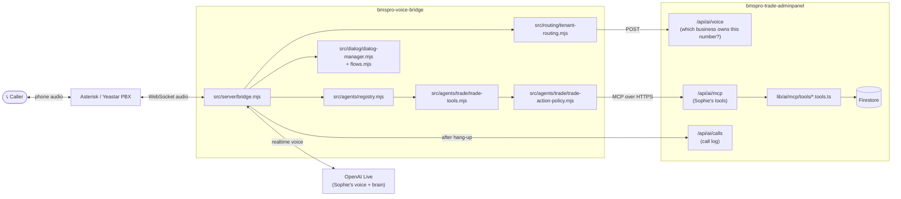
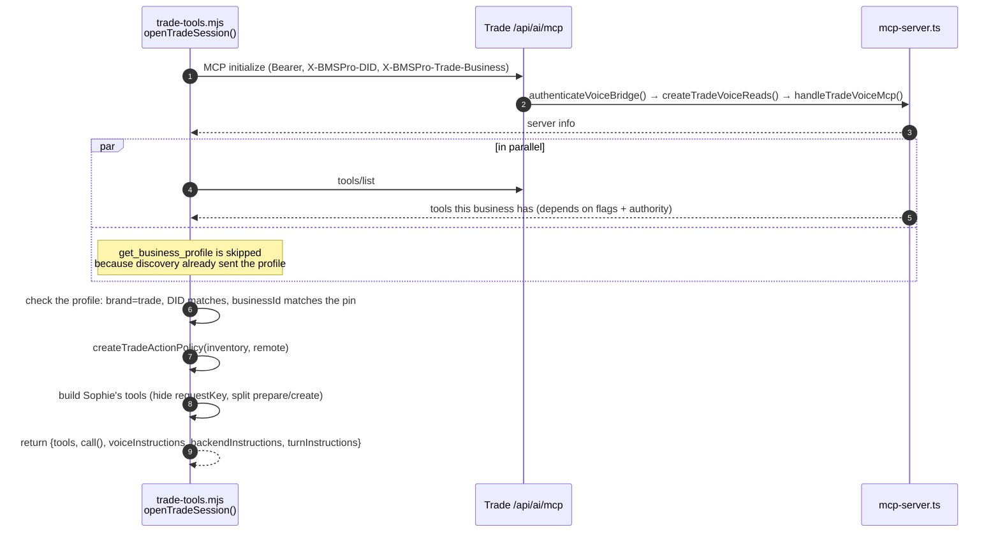
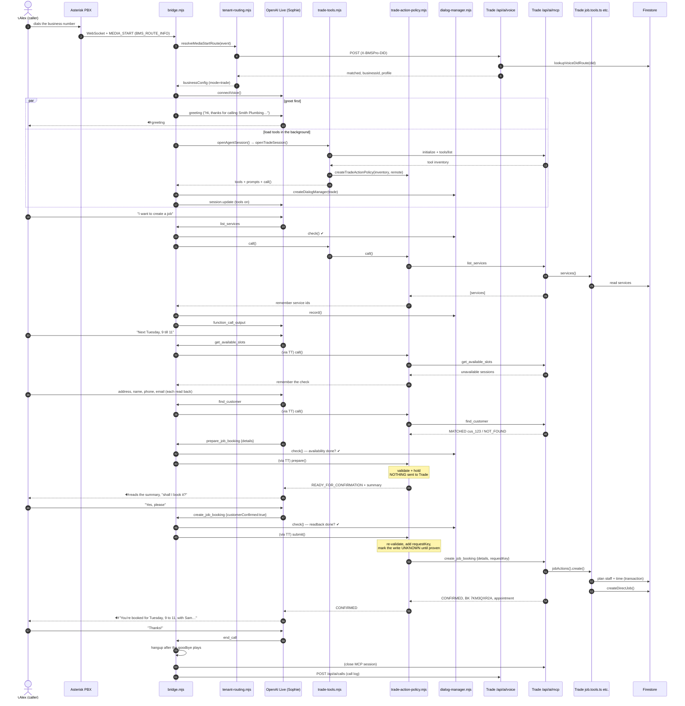
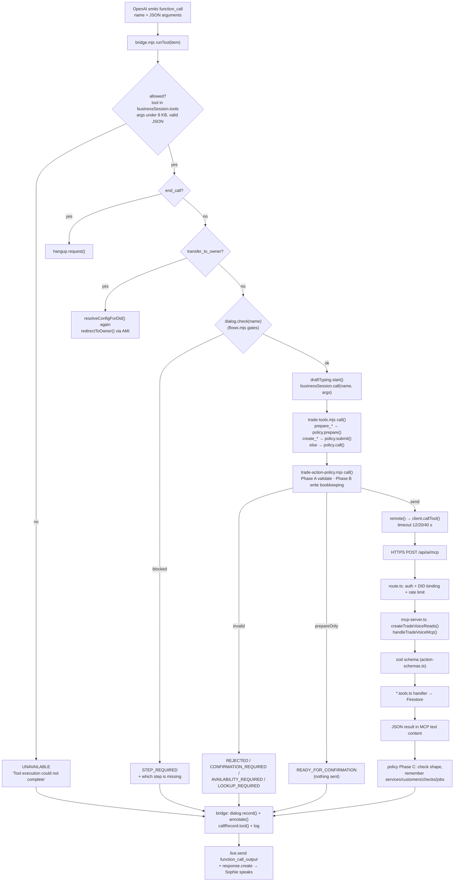
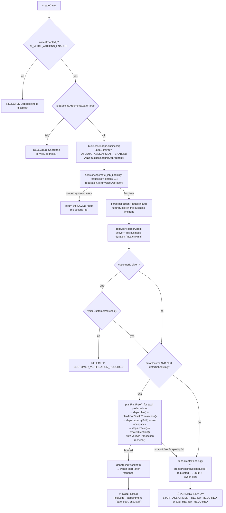
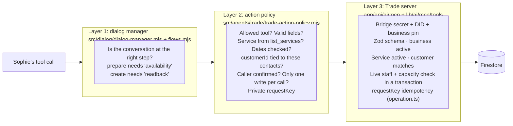

# Trade job call walkthrough: from "Hello" to a booked job

This guide follows one customer phone call to a Trade business, where the caller asks Sophie to
book a job. At each step of the conversation it shows which **file**, which **function** and
which **HTTP route** runs, in both projects:

- **Voice bridge**: `bmspro-voice-bridge` (Node.js, runs next to the phone system)
- **Trade admin panel**: `bmspro-trade-adminpanel/bmspro-trade-adminpanel` (Next.js, the Trade app and its API)

> The conversation below is an **example**. Sophie's exact wording comes from the AI model and
> changes from call to call. The files, functions, routes and rules are taken from the code.

---

## Contents

1. [The big picture](#1-the-big-picture)
2. [Who is who: the files](#2-who-is-who-the-files)
3. [The routes between the two projects](#3-the-routes-between-the-two-projects)
4. [The example call, turn by turn](#4-the-example-call-turn-by-turn)
5. [Full sequence diagram](#5-full-sequence-diagram)
6. [Deep dive: one tool call end to end](#6-deep-dive-one-tool-call-end-to-end)
7. [Deep dive: how Trade books the job](#7-deep-dive-how-trade-books-the-job)
8. [The three safety layers](#8-the-three-safety-layers)
9. [Every result Sophie can get back](#9-every-result-sophie-can-get-back)
10. [Feature flags that change the call](#10-feature-flags-that-change-the-call)
11. [Quick reference: function index](#11-quick-reference-function-index)

---

## 1. The big picture



In one sentence: **the PBX streams the caller's audio to the bridge, the bridge streams it to
OpenAI (Sophie), and whenever Sophie needs real data or wants to save something, the bridge
checks the request and forwards it to Trade's MCP route, which reads or writes Firestore.**

Sophie never talks to Trade directly. Every tool call goes through the bridge, which checks it
three times (see [section 8](#8-the-three-safety-layers)).

---

## 2. Who is who: the files

### Voice bridge (`bmspro-voice-bridge`)

| File | Main functions | Job in this call |
|---|---|---|
| `bridge.mjs` (repo root) | none | Entry point. Just imports `src/server/bridge.mjs`. |
| `src/server/bridge.mjs` | `wss.on('connection')`, `prepareBusiness()`, `runTool()`, `enableTradeTools()` | Owns the call: audio, OpenAI Live connection, routing, tool dispatch, hang-up. |
| `src/routing/tenant-routing.mjs` | `resolveMediaStartRoute()`, `didForMediaStart()`, `resolveConfigForDid()` | Works out which Trade business was called. |
| `src/agents/registry.mjs` | `openAgentSession()`, `openingGreeting()` | Picks the agent for the call mode (`trade` → `openTradeSession`). |
| `src/agents/trade/trade-tools.mjs` | `openTradeSession()`, `toolTimeoutMs()`, `jobInstructions()` | Connects to Trade over MCP, builds Sophie's tools and prompts. |
| `src/agents/trade/trade-action-policy.mjs` | `createTradeActionPolicy()` → `prepare()`, `submit()`, `call()` | Checks and validates every tool call before Trade sees it. |
| `src/dialog/dialog-manager.mjs` + `flows.mjs` | `createDialogManager()` → `check()`, `record()`, `annotate()` | Tracks conversation steps. Blocks a save that comes too early. |
| `src/agents/end-call.mjs` | `END_CALL_TOOL`, `createHangupController()` | Lets Sophie hang up after her goodbye. |
| `src/agents/trade/trade-owner-handoff.mjs` | `ownerHandoffReadiness()`, `redirectToOwner()` | Optional `transfer_to_owner` tool. |
| `src/agents/trade/trade-live-listen.mjs` | `createLiveListen()` → `start()` | Optional: the owner listens in from the dashboard. |
| `src/audio/*.mjs` | `createInputAudioClock()`, `createDraftTypingCue()`, `createBargeInDetector()` | Audio pacing, the typing sound while a tool runs, and stopping Sophie when the caller interrupts. |
| `src/observability/call-record.mjs` | `createCallRecord()`, `sendTradeCallRecord()` | Builds the call log and posts it to Trade after hang-up. |
| `src/observability/call-transcript.mjs` | `createCallTranscript()` | Local transcript file. |

### Trade admin panel (`bmspro-trade-adminpanel/bmspro-trade-adminpanel`)

| File | Main functions | Job in this call |
|---|---|---|
| `app/api/ai/voice/route.ts` | `POST` | Discovery: "which business owns this phone number?" |
| `app/api/ai/mcp/route.ts` | `POST`, `allowVoiceRequest()` | Every Sophie tool call arrives here. Authenticates and rate-limits it. |
| `lib/ai/config.ts` | `authenticateVoiceBridgeCredential()`, `authenticateVoiceBridge()` | Checks the bridge secret, the DID and the business pin. |
| `lib/ai/data/did-mappings.ts` | `lookupVoiceDidRoute()`, `resolveVoiceDidMapping()` | Phone number → business, from **Super Admin → DID mappings**. |
| `lib/ai/mcp/mcp-server.ts` | `createTradeVoiceReads()`, `handleTradeVoiceMcp()` | Decides which tools exist, and registers them on an MCP server. |
| `lib/ai/mcp/tools/action-schemas.ts` | `jobBookingArguments`, `availabilityArguments`, ... | Zod schemas: the exact arguments each tool accepts. |
| `lib/ai/mcp/tools/service.tools.ts` | `createTradeServiceTools()` → `profile`, `services`, `business` | `get_business_profile`, `list_services`, and the active-business check. |
| `lib/ai/mcp/tools/customer.tools.ts` | `customerActions()` → `find`, `register` | `find_customer`, `register_customer`. |
| `lib/ai/mcp/tools/booking.tools.ts` | `bookingActions()` → `availability`, `create` | `get_available_slots`, `create_inspection_request`. |
| `lib/ai/mcp/tools/job.tools.ts` | `jobActions()` → `lookup`, `create`, `reschedule`, `cancel`; `planFirstFree()` | `find_job`, `create_job_booking`, `reschedule_job`, `cancel_job`. |
| `lib/ai/mcp/tools/knowledge.tools.ts` | `createVoiceKnowledgeTools()` | `search_business_knowledge`. |
| `lib/ai/mcp/tools/operation.ts` | `runVoiceOperation()`, `voiceOperationStore()` | Idempotency: one `requestKey` saves at most once. |
| `lib/team/ai-assignment-server.ts` | `planAiJobVisitInTransaction()` | Picks a qualified, free staff member and an exact time. |
| `lib/calendar/slot-occupancy.ts` | `computeDaySlotOccupancy()`, `rangeOverlapsFullSlots()` | Hourly job capacity check. |
| `lib/bookings/server.ts` | `createDirectJob()`, `createPendingJobRequest()` | Writes the job (or the pending request) to Firestore. |
| `lib/notifications/sophie-owner-alert.ts` | `sendSophieInspectionOwnerAlert()` | Tells the owner "Sophie booked a job". |
| `lib/audit/server.ts` | `logAuditEvent()` | Audit trail entry. |
| `app/api/ai/calls/route.ts` | `POST` | Receives the call log after hang-up. |

---

## 3. The routes between the two projects

| # | Direction | Route | When | Auth | Handled by |
|---|---|---|---|---|---|
| 1 | bridge → Trade | `POST /api/ai/voice` | Once, when the call starts | `Bearer` bridge secret + `X-BMSPro-DID` | `app/api/ai/voice/route.ts` |
| 2 | bridge → Trade | `POST /api/ai/mcp` | Once to connect, then **once per tool call** | `Bearer` + `X-BMSPro-DID` + `X-BMSPro-Trade-Business` | `app/api/ai/mcp/route.ts` → `lib/ai/mcp/mcp-server.ts` |
| 3 | bridge → Trade | `POST /api/ai/calls` | Once, after hang-up | shared token | `app/api/ai/calls/route.ts` |
| 4 | bridge ↔ OpenAI | Live WebSocket | Whole call | `OPENAI_API_KEY` | OpenAI |

On the bridge side, the URLs come from `.env`:

- `BMSPRO_TRADE_MCP_URL` → the `/api/ai/mcp` URL. `tenant-routing.mjs` derives `/api/ai/voice` from it.
- `BMSPRO_TRADE_BRIDGE_SECRET` → the bearer secret. On Trade this must equal `AI_VOICE_BRIDGE_SECRET`.

On the Trade side, `AI_VOICE_DIRECT_ENABLED=true` must be set, or every route returns **404**
(`authenticateVoiceBridgeCredential()` in `lib/ai/config.ts`).

> **Important:** Trade's `/api/ai/mcp` is **stateless**. Every tool call is a separate HTTP
> request, and for each one Trade authenticates again, looks up the DID mapping again, builds the
> tool list again (`createTradeVoiceReads`) and creates a fresh `McpServer`
> (`handleTradeVoiceMcp`). The *bridge* is what remembers things during the call: the policy's
> maps of services, customers, availability checks and held details.

---

## 4. The example call, turn by turn

Example details used below (all made up):

- Business: **"Smith Plumbing"**, timezone `Australia/Melbourne`
- Service: **"Hot water repair"** (service id `svc_hw01`, 120 minutes)
- Caller: **Alex Taylor**, `0412 345 678`, `alex@example.com`
- Site: **12 Main St, Richmond VIC 3121**
- Preferred time: **Tuesday 25 November 2026, morning, 9:00 to 11:00**

---

### Step 0: the phone rings (before anyone speaks)

```
☎️  Alex dials Smith Plumbing's number (DID 0390001234).
```

| # | Where | Function | What happens |
|---|---|---|---|
| 0.1 | PBX | dialplan | Asterisk answers and opens a WebSocket to the bridge, putting the DID in `BMS_ROUTE_INFO`. |
| 0.2 | `src/server/bridge.mjs` | `wss.on('connection', media => …)` | A new call starts. It creates `callId`, `createCallTranscript()`, `createCallRecord()` and `createHangupController()`, then waits for `MEDIA_START`. |
| 0.3 | `src/server/bridge.mjs` | `MEDIA_START` handler | It checks the audio format (`ulaw`, 160-byte frames). |
| 0.4 | `src/routing/tenant-routing.mjs` | `resolveMediaStartRoute()` → `didForMediaStart()` | It reads `0390001234` out of the `BMS_ROUTE_INFO` marker. |
| 0.5 | `src/routing/tenant-routing.mjs` | `resolveConfigForDid()` | It sends **`POST /api/ai/voice`** with `X-BMSPro-DID: 0390001234`. |
| 0.6 | Trade `app/api/ai/voice/route.ts` | `POST` | `authenticateVoiceBridgeCredential()` checks the secret. The rate limit is 240 a minute. `lookupVoiceDidRoute(did)` finds the business. |
| 0.7 | Trade → bridge | response | `{matched: true, brand: "trade", businessId, profile: {businessName: "Smith Plumbing", timezone}, forwardingExtension?, callback?}` |
| 0.8 | `tenant-routing.mjs` | `resolveConfigForDid()` | It builds `businessConfig = {mode: 'trade', url, token, did, businessId, discoveredProfile, routingHeaders}`. |
| 0.9 | `src/server/bridge.mjs` | `connectVoice()` | It opens the OpenAI Live connection straight away (Trade mode). |
| 0.10 | `src/server/bridge.mjs` | `prepareBusiness()` (in the background) | It calls `openAgentSession()` from `registry.mjs`, which calls `openTradeSession()` from `trade-tools.mjs`. See below. |

**What `openTradeSession()` does (`src/agents/trade/trade-tools.mjs`):**



Back in `bridge.mjs`, `prepareBusiness()` then does three things:
- It calls `ownerHandoffReadiness()` (`trade-owner-handoff.mjs`). If it returns `READY`, it adds the `transfer_to_owner` tool.
- It calls `createDialogManager({mode: 'trade'})` (`dialog-manager.mjs`), which loads the `trade` steps from `flows.mjs`.
- It calls `enableTradeTools()`, which sends a `session.update` to OpenAI with Sophie's tools and her backend instructions.

> **Greet first.** Because discovery already gave the business name and timezone, `greetFirst`
> is true, so Sophie greets **while the tools are still loading**. The tools are switched on in
> OpenAI as soon as `openTradeSession()` finishes. If the MCP setup fails, Sophie is told to say
> she cannot complete actions on this call.

---

### Turn 1: the greeting

> 🤖 **Sophie:** "Hi, thanks for calling Smith Plumbing. My name is Sophie, your AI receptionist. How can I help?"

| Where | Function | What happens |
|---|---|---|
| `src/server/bridge.mjs` | Step 3 `greeting` (`greetFirst` branch) | The fixed greeting text is chosen. Sophie is told to pronounce her name "SOH-fee". |
| `src/server/bridge.mjs` | `startVoice()` | It sends the greeting to OpenAI, and the audio streams back to the caller through the PBX. |
| `src/agents/trade/trade-live-listen.mjs` | `liveListen.start()` | If live listen is enabled, the owner can now hear the call in the dashboard. |

No tool is called yet. The rules say "Do not call a tool before greeting".

---

### Turn 2: the caller asks for a job

> 👤 **Alex:** "Hello, I want to create a job for me. My hot water isn't working."
>
> 🤖 **Sophie:** "Oh, that's a hassle. Let's get that sorted. Let me check what we can book."

Sophie decides she needs the service list. **Tool call: `list_services`.**

| # | Where | Function | What happens |
|---|---|---|---|
| 2.1 | OpenAI | function call | Sophie emits `list_services {}`. |
| 2.2 | `src/server/bridge.mjs` | `runTool(item)` | It checks the tool is in `businessSession.tools`, parses the arguments, and runs `dialog.check('list_services')`, which does not block it. |
| 2.3 | `src/audio/draft-typing.mjs` | `draftTyping.start()` | The caller hears a soft typing sound while the tool runs. |
| 2.4 | `trade-tools.mjs` | session `call(name, args)` | This is not a prepare or create tool, so it goes to `policy.call('list_services', {})`. |
| 2.5 | `trade-action-policy.mjs` | `call()` Phase A | `baseTools` requires empty arguments, so `args = {}`. |
| 2.6 | `trade-action-policy.mjs` | `call()` Phase C → `remote()` | `remote()` comes from `trade-tools.mjs`: `client.callTool({name: 'list_services'})` with a 20 s timeout. |
| 2.7 | Trade `app/api/ai/mcp/route.ts` | `POST` | `authenticateVoiceBridgeCredential()`, `authenticateVoiceBridge()` (DID → business, pin check) and `allowVoiceRequest()` (120 a minute per DID). |
| 2.8 | Trade `lib/ai/mcp/mcp-server.ts` | `createTradeVoiceReads()` → `handleTradeVoiceMcp()` | It builds the tools, and MCP dispatches to `list_services`. |
| 2.9 | Trade `lib/ai/mcp/tools/service.tools.ts` | `services()` | It reads `businesses/{id}`, checking the business is active (cached for 10 s), and `services where businessId == …`, keeping only `isActive === true`. |
| 2.10 | Trade → bridge | MCP result | `[{id: "svc_hw01", name: "Hot water repair", defaultDurationMin: 120}, …]` |
| 2.11 | `trade-action-policy.mjs` | `call()` Phase C | It checks every service has a valid `id` and `name`, then **remembers the ids** in `services`. Only these can be booked. |
| 2.12 | `src/server/bridge.mjs` | `runTool()` | It calls `dialog.record()` (step `service` done) and `dialog.annotate()` (adds `dialogState`). Then it logs `MCP tool: list_services status=completed`, calls `callRecord.tool()`, and sends `function_call_output` plus `response.create` to OpenAI. |

> 🤖 **Sophie:** "We can book a hot water repair. Is that the one you need?"
>
> 👤 **Alex:** "Yes, that one."

---

### Turn 3: the date and time

The job rules (`jobInstructions()` in `trade-tools.mjs`) say: **ask for the date first, then the
rough start and finish time.**

> 🤖 **Sophie:** "What day would suit you?"
>
> 👤 **Alex:** "Next Tuesday."
>
> 🤖 **Sophie:** "That's Tuesday the 25th of November. Let me check that day."

**Tool call: `get_available_slots`**, which runs straight away, before the next question.

| # | Where | Function | What happens |
|---|---|---|---|
| 3.1 | `bridge.mjs` | `runTool()` | Same path as before. |
| 3.2 | `trade-action-policy.mjs` | `call()` Phase A | It checks `only(raw, ['from','to'])`, that both are real dates, and that the range is under 90 days, so `args = {from: '2026-11-25', to: '2026-11-25'}`. |
| 3.3 | Trade `mcp/route.ts` → `mcp-server.ts` | `get_available_slots` | This uses the `availabilityArguments` zod schema. |
| 3.4 | Trade `lib/ai/mcp/tools/booking.tools.ts` | `bookingActions().availability()` → `computeUnavailableSlots()` (`lib/booking/slot-availability`) | It returns `{brand: 'trade', from, to, timezone, unavailable: [...], sessions: ['morning','afternoon']}`. |
| 3.5 | `trade-action-policy.mjs` | `call()` Phase C | It checks `brand === 'trade'` and that `from` and `to` match, then **stores the check** in `checks` (the last 20 are kept). |
| 3.6 | `bridge.mjs` | `dialog.record()` | Step `availability` is done. |

> 🤖 **Sophie:** "Tuesday's open. Roughly what time would you like us to start and finish, or should the owner work out the times?"
>
> 👤 **Alex:** "Nine till eleven in the morning."
>
> 🤖 **Sophie:** "Nine to eleven on Tuesday morning. Would you like to add a second preferred date, or keep just that one?"
>
> 👤 **Alex:** "Just that one."

Nothing is saved yet. Sophie keeps `{date: '2026-11-25', timeRange: 'morning', startTime: '09:00', endTime: '11:00'}` in the conversation.

---

### Turn 4: the address

> 🤖 **Sophie:** "What's the job address?"
>
> 👤 **Alex:** "12 Main Street, Richmond, Victoria, 3121."
>
> 🤖 **Sophie:** "12 Main Street, Richmond, VIC 3121. Got it."

No tool call is made. The address is validated later, inside `prepare_job_booking` (`address()` in the policy).

---

### Turn 5: name, phone, email (one checkpoint each)

The rules in `turnInstructions` (`trade-tools.mjs`) say to **read back each detail straight away and
wait for a yes before moving on.**

> 🤖 **Sophie:** "What name should I put this under?"
>
> 👤 **Alex:** "Alex Taylor."
>
> 🤖 **Sophie:** "Alex Taylor. Did I get that right?"
>
> 👤 **Alex:** "Yes."
>
> 🤖 **Sophie:** "And the best mobile number?"
>
> 👤 **Alex:** "0412 345 678."
>
> 🤖 **Sophie:** "0412, 345, 678. Did I get that number right?"
>
> 👤 **Alex:** "Yep."
>
> 🤖 **Sophie:** "And your email?"
>
> 👤 **Alex:** "alex@example.com."
>
> 🤖 **Sophie:** "alex at example dot com. Is that email right?"
>
> 👤 **Alex:** "That's right."

**Tool call: `find_customer`**, to see whether Alex already has an account with this business.

| # | Where | Function | What happens |
|---|---|---|---|
| 5.1 | `trade-action-policy.mjs` | `call()` Phase A → `contact(raw)` | It lowercases the email, keeps only the phone digits (`0412345678`), and checks the formats. |
| 5.2 | Trade `lib/ai/mcp/tools/customer.tools.ts` | `customerActions().find()` | It queries `customers where registeredBusinessId == business AND email == …`. There must be exactly one match, with the same phone and an enabled account. |
| 5.3 | Trade → bridge | result | `{status: 'MATCHED', customerId: 'cus_123'}` or `{status: 'NOT_FOUND'}` |
| 5.4 | `trade-action-policy.mjs` | `call()` Phase C | On `MATCHED` it **remembers** `customers.set('cus_123', contactKey(email, phone))`. That `customerId` can only be used again with the same email and phone. |
| 5.5 | `bridge.mjs` | `dialog.record()` | Step `contact` is done. |

`NOT_FOUND` is fine, because the job is then booked as a **guest** (`customerId: null`). Sophie
does not push account creation; `register_customer` needs the caller's explicit consent.

---

### Turn 6: prepare and read back (still nothing saved)

**Tool call: `prepare_job_booking`.** This tool exists **only in the bridge**. Trade never sees it.

```json
{
  "serviceId": "svc_hw01",
  "customerId": "cus_123",
  "customer": {"fullName": "Alex Taylor", "email": "alex@example.com", "phone": "0412 345 678"},
  "address": {"street": "12 Main St", "suburb": "Richmond", "state": "VIC", "postcode": "3121"},
  "preferredSlots": [{"date": "2026-11-25", "timeRange": "morning", "startTime": "09:00", "endTime": "11:00"}],
  "customerNotes": "Hot water not working"
}
```

| # | Where | Function | What happens |
|---|---|---|---|
| 6.1 | `bridge.mjs` | `runTool()` → `dialog.check('prepare_job_booking')` | **Gate:** step `availability` must already be done (`flows.mjs` → `gates.prepare_job_booking`). It is done, so the call goes through. |
| 6.2 | `trade-tools.mjs` | session `call()` | `prepare_job_booking` goes to `policy.prepare(args, 'create_job_booking')`. |
| 6.3 | `trade-action-policy.mjs` | `prepare()` | It refuses if the model sent `customerConfirmed` itself. It then calls `call('create_job_booking', {...raw, customerConfirmed: true}, {prepareOnly: true})`. |
| 6.4 | `trade-action-policy.mjs` | `call()` Phase A (the `create_job_booking` branch) | These checks run in order:<br/>• only the allowed fields are present<br/>• `services.has('svc_hw01')`, which must come from `list_services` in **this call**<br/>• `address()`: street, suburb and state are present, postcode is 4 digits<br/>• `sessions(..., true, true)`: 1–3 distinct sessions, HH:MM times, finish after start<br/>• `customers.get('cus_123') === contactKey(...)`: the id belongs to these contacts<br/>• notes are under 2000 characters<br/>• `unchecked(slots)`: every date was checked and is not unavailable |
| 6.5 | `trade-action-policy.mjs` | `call()` Phase B | It checks there is no earlier write for this tool, then `prepareOnly` applies: `prepared.set('create_job_booking', args)`. |
| 6.6 | bridge → Sophie | result | `{status: 'READY_FOR_CONFIRMATION', summary: {...}, message: '...held in this call, not saved...'}` |
| 6.7 | `bridge.mjs` | `dialog.record()` | Steps `readback` and `address` are done. |

> 🤖 **Sophie:** "Here's what I've got: a hot water repair at 12 Main Street, Richmond VIC 3121, on Tuesday the 25th of November, 9 to 11 in the morning, for Alex Taylor, 0412 345 678, alex at example dot com. Is that all correct, and shall I book it?"
>
> 👤 **Alex:** "Yes, please."

---

### Turn 7: submit (the only step that saves)

**Tool call: `create_job_booking {"customerConfirmed": true}`.** Sophie sends **only the
confirmation**. The bridge supplies the details it validated and held in Turn 6.

#### In the bridge

| # | Where | Function | What happens |
|---|---|---|---|
| 7.1 | `bridge.mjs` | `runTool()` → `dialog.check('create_job_booking')` | **Gate:** step `readback` must be done. It is. |
| 7.2 | `trade-tools.mjs` | session `call()` | `create_job_booking` goes to `policy.submit(args, 'create_job_booking')`. |
| 7.3 | `trade-action-policy.mjs` | `submit()` | It requires the arguments to be exactly `{customerConfirmed: true}` and the prepared details to exist. It then calls `call(name, structuredClone(prepared))`. |
| 7.4 | `trade-action-policy.mjs` | `call()` Phase A | It re-validates everything (same checks as 6.4). |
| 7.5 | `trade-action-policy.mjs` | `call()` Phase B | It saves a `fingerprint` (the canonical JSON of the arguments) and creates `requestKey = randomUUID()`. It stores `writes.set(name, {fingerprint, requestKey, result: UNKNOWN})`, so the result is **UNKNOWN until Trade proves otherwise**. |
| 7.6 | `trade-action-policy.mjs` | `call()` Phase C → `remote()` | It sends `create_job_booking {...args, requestKey}` with a 40 s write timeout. |

#### In Trade

| # | Where | Function | What happens |
|---|---|---|---|
| 7.7 | `app/api/ai/mcp/route.ts` | `POST` | Auth, DID → business, pin check and rate limit. `createTradeVoiceReads(binding, schedule)`, where `schedule` uses Next's `after()` for work done after the response. |
| 7.8 | `lib/ai/mcp/mcp-server.ts` | `create_job_booking` registered | Only if `AI_VOICE_ACTIONS_ENABLED=true`. The arguments are checked with `jobBookingArguments`, then passed through the `write()` wrapper, which turns a crash into `UNKNOWN`. |
| 7.9 | `lib/ai/mcp/tools/job.tools.ts` | `jobActions().create()` | This is the booking logic. [Section 7](#7-deep-dive-how-trade-books-the-job) covers it in detail. |
| 7.10 | `lib/bookings/server.ts` | `createDirectJob()` | It writes the job to Firestore `jobs`, inside a transaction that re-checks the staff member is still free. |
| 7.11 | after the response | `done()` → `schedule('sophie-job-booked-alert')` | `sendSophieInspectionOwnerAlert()` sends "Sophie booked a job" to the owner. |

#### Back in the bridge

| # | Where | Function | What happens |
|---|---|---|---|
| 7.12 | `trade-action-policy.mjs` | `call()` Phase C | It checks success: `status === 'CONFIRMED'`, a valid `jobCode` (`BK` plus 9 characters), and a valid `appointment.date` and `startTime`. Then `state.result = result`. |
| 7.13 | `bridge.mjs` | `runTool()` | `dialog.record()` marks step `submitted` done. It logs `MCP tool: create_job_booking status=CONFIRMED`, and `callRecord.tool()` records it for the call log. |

The result Sophie receives:

```json
{
  "status": "CONFIRMED",
  "jobCode": "BK 7KM3QXR2A",
  "appointment": {"date": "2026-11-25", "session": "morning", "startTime": "09:00", "endTime": "11:00",
                  "timezone": "Australia/Melbourne", "inspectorName": "Sam"},
  "message": "The job is booked. Tell the caller the returned date, start and finish times, assigned staff name, and job reference..."
}
```

> 🤖 **Sophie:** "You're booked for Tuesday the 25th, 9 to 11 in the morning, with Sam. Your job reference is B, K, 7, K, M, 3, Q, X, R, 2, A. You'll need that if you want to change it later."

If Trade could not confirm a time, Sophie would get `PENDING_REVIEW` instead and say:

> 🤖 **Sophie:** "Your job request is in. The team will confirm the time."

---

### Turn 8: goodbye and hang-up

> 👤 **Alex:** "Great, thanks!"
>
> 🤖 **Sophie:** "No worries, Alex. Have a good day!"

| # | Where | Function | What happens |
|---|---|---|---|
| 8.1 | OpenAI | function call `end_call` | Sophie asks to hang up. |
| 8.2 | `bridge.mjs` | `runTool()` (`endCall` branch) | `hangup.request()` from `end-call.mjs` waits until her goodbye audio has finished playing. |
| 8.3 | `bridge.mjs` | `finish()` | It closes the OpenAI connection, the MCP session (`client.close()`) and live listen. |
| 8.4 | `src/observability/call-record.mjs` | `sendTradeCallRecord()` | **`POST /api/ai/calls`**: the call log with tool results, durations and the caller's number. |
| 8.5 | Trade `app/api/ai/calls/route.ts` | `POST` | It saves the call so it shows up in the dashboard's call list. |

---

## 5. Full sequence diagram



---

## 6. Deep dive: one tool call end to end

This is the exact path for **any** Sophie tool, using `create_job_booking` as the example.



Tool calls run **one at a time** (`toolQueue` in `bridge.mjs`), and each `call_id` runs only
once (`handledCalls`).

---

## 7. Deep dive: how Trade books the job

`lib/ai/mcp/tools/job.tools.ts`, function `jobActions(binding, deps).create(raw)`:



What each decision means for the caller:

| Situation | Result | What Sophie says |
|---|---|---|
| Auto-assign on, Sophie has job authority, a qualified staff member is free | `CONFIRMED` | Date, start and finish, staff name, job reference. |
| Same, but nobody is free for the whole job at any preferred time | `PENDING_REVIEW` (`STAFF_ASSIGNMENT_REVIEW_REQUIRED`) | "Your job request is in. The team will confirm the time." |
| Caller said "let the owner decide the time" (`deferScheduling: true`) | `PENDING_REVIEW` (`JOB_REVIEW_REQUIRED`) | Same, and the team picks the time and staff member. |
| Sophie has no job authority, or auto-assign is off | `PENDING_REVIEW` (`JOB_REVIEW_REQUIRED`) | Same. |
| Someone else took the time between planning and saving | `planChanged`, so it tries the next preference or staff member | Handled automatically. |
| Trade crashed or timed out | `UNKNOWN` | "Staff will need to check." She **never** retries. |

A pending request shows in the Trade dashboard under **Jobs → Call jobs awaiting scheduling**, and
the owner gets an alert telling them to "choose Schedule job".

> **Price:** Sophie never quotes one. The job is booked without a price, and the team sets it
> later. An invoice is **not** created on the call. Invoices come later, from an accepted
> quotation (`lib/ai/mcp/tools/invoice.tools.ts` → `draftAcceptedQuotationInvoice()`), and only
> through the staff-only `/api/ai/internal-mcp` route.

---

## 8. The three safety layers

Sophie is an AI and can make mistakes. Three separate layers stop a mistake from becoming a wrong
booking:



| Mistake Sophie might make | Which layer stops it |
|---|---|
| Submits before reading back | Layer 1 (`STEP_REQUIRED`) and Layer 2 (`PREPARATION_REQUIRED`) |
| Invents a service id | Layer 2 (`services.has()`) and Layer 3 (`deps.service()`) |
| Books a date she never checked | Layer 1 (`availability` gate) and Layer 2 (`unchecked()`) |
| Uses another customer's id | Layer 2 (`customers.get() === contactKey`) and Layer 3 (`voiceCustomerMatches`) |
| Sends `businessId` or `requestKey` herself | Layer 2 (`REJECTED`). These fields are also hidden from her schema in `trade-tools.mjs`. |
| Submits twice | Layer 2 (fingerprint and one write per call) and Layer 3 (`once()` with the same `requestKey`) |
| Network drops mid-save | Layer 2 returns `UNKNOWN`, and Sophie is told never to resubmit |
| Someone else books the slot at the same moment | Layer 3 (`recheck()` in the transaction, `PlanChangedError`) |

---

## 9. Every result Sophie can get back

| Status | Comes from | Meaning |
|---|---|---|
| `READY_FOR_CONFIRMATION` | policy (`prepare`) | Details valid and held. Nothing saved. Read back and ask. |
| `CONFIRMATION_REQUIRED` | policy | `customerConfirmed` was missing or false. |
| `PREPARATION_REQUIRED` | policy (`submit`) | Tried to submit without preparing first. |
| `AVAILABILITY_REQUIRED` | policy | A preferred date was not checked, or the session is unavailable. |
| `LOOKUP_REQUIRED` | policy | Tried to reschedule or cancel without `find_job` in this call. |
| `STEP_REQUIRED` | dialog manager | An earlier conversation step is missing. |
| `REJECTED` | policy or Trade | Invalid input, or not allowed. `message` says what to fix. |
| `MATCHED` / `NOT_FOUND` | Trade (`find_customer`, `find_job`) | Lookup result. `NOT_FOUND` never reveals whether something exists. |
| `CONFIRMED` | Trade | Booked or moved. Includes `jobCode` and `appointment`. |
| `PENDING_REVIEW` | Trade | Saved for the team to schedule. **Not** booked. |
| `CANCELLED` | Trade | Job cancelled. |
| `CREATED` / `EXISTS` | Trade (`register_customer`) | Customer account result. |
| `UNAVAILABLE` | bridge, policy or Trade | A read failed. Don't guess. |
| `UNKNOWN` | policy or Trade | A write may or may not have saved. Staff must check. **Never retry.** |

---

## 10. Feature flags that change the call

| Flag / setting | Where | Effect on this call |
|---|---|---|
| `AI_VOICE_DIRECT_ENABLED=true` | Trade env | Without it, every bridge route returns 404 and Sophie has no Trade at all. |
| `AI_VOICE_BRIDGE_SECRET` | Trade env | Must equal the bridge's `BMSPRO_TRADE_BRIDGE_SECRET`. |
| **Super Admin → DID mappings** | Trade dashboard | Number → business. Without a mapping, discovery returns `matched: false`. |
| `AI_VOICE_ACTIONS_ENABLED=true` | Trade env | Turns on writes: `register_customer`, `create_inspection_request`, `create_job_booking`. Without it Sophie can only look things up. |
| `sophieJobAuthority` | business document | Required for `cancel_job` and `reschedule_job`, and for jobs to be auto-confirmed. |
| `AI_AUTO_ASSIGN_STAFF_ENABLED=true` | Trade env | Lets Trade pick staff and confirm (`CONFIRMED`). Without it, every job is `PENDING_REVIEW`. Also needed for `reschedule_job`. |
| `AI_VOICE_KNOWLEDGE_ENABLED=true` | Trade env | Adds `search_business_knowledge`. |
| `forwardingExtension` (DID mapping) + `BMSPRO_HANDOFF_AMI_*` | Trade + bridge env | Adds `transfer_to_owner`. |
| `BMSPRO_DIALOG_MANAGER` | bridge env | `on` (default) blocks, `observe` only logs, `off` disables the dialog manager. |
| `BMSPRO_LIVE_LISTEN_ENABLED=true` | bridge env | The owner can listen to live calls. |

---

## 11. Quick reference: function index

### Voice bridge

| Function | File | Called by | Calls |
|---|---|---|---|
| `wss.on('connection')` | `src/server/bridge.mjs` | PBX WebSocket | everything below |
| `resolveMediaStartRoute()` | `src/routing/tenant-routing.mjs` | `bridge.mjs` | `didForMediaStart()`, `resolveConfigForDid()` |
| `resolveConfigForDid()` | `src/routing/tenant-routing.mjs` | `resolveMediaStartRoute()`, `transfer_to_owner` | `POST /api/ai/voice` |
| `prepareBusiness()` | `src/server/bridge.mjs` | `MEDIA_START` handler | `openAgentSession()`, `ownerHandoffReadiness()`, `createDialogManager()`, `enableTradeTools()` |
| `openAgentSession()` | `src/agents/registry.mjs` | `prepareBusiness()` | `openTradeSession()` |
| `openTradeSession()` | `src/agents/trade/trade-tools.mjs` | `openAgentSession()` | MCP `connect`, `listTools`, `createTradeActionPolicy()` |
| `createTradeActionPolicy()` | `src/agents/trade/trade-action-policy.mjs` | `openTradeSession()` | none (returns `{names, prepare, submit, call}`) |
| `runTool()` | `src/server/bridge.mjs` | OpenAI `function_call` events | `dialog.check()`, `businessSession.call()`, `dialog.record()` |
| session `call()` | `src/agents/trade/trade-tools.mjs` | `runTool()` | `policy.prepare()` / `submit()` / `call()` |
| `policy.prepare()` | `trade-action-policy.mjs` | session `call()` for `prepare_*` | `policy.call(…, {prepareOnly: true})` |
| `policy.submit()` | `trade-action-policy.mjs` | session `call()` for `create_*` | `policy.call()` with the held details |
| `policy.call()` | `trade-action-policy.mjs` | the above, and every other tool | `remote()`, which is `client.callTool()` |
| `dialog.check()` / `record()` / `annotate()` | `src/dialog/dialog-manager.mjs` | `runTool()` | `flows.mjs` (`trade` steps and gates) |
| `hangup.request()` | `src/agents/end-call.mjs` | `runTool()` for `end_call` | none |
| `sendTradeCallRecord()` | `src/observability/call-record.mjs` | `finish()` | `POST /api/ai/calls` |

### Trade admin panel

| Function | File | Called by | Calls |
|---|---|---|---|
| `POST` | `app/api/ai/voice/route.ts` | bridge discovery | `authenticateVoiceBridgeCredential()`, `lookupVoiceDidRoute()` |
| `POST` | `app/api/ai/mcp/route.ts` | every bridge MCP request | `authenticateVoiceBridge()`, `allowVoiceRequest()`, `createTradeVoiceReads()`, `handleTradeVoiceMcp()` |
| `authenticateVoiceBridge()` | `lib/ai/config.ts` | MCP route | `authenticateVoiceBridgeCredential()`, `resolveVoiceDidMapping()` |
| `createTradeVoiceReads()` | `lib/ai/mcp/mcp-server.ts` | MCP route | `createTradeServiceTools()`, `createVoiceCustomerTools()`, `createVoiceBookingTools()`, `createVoiceJobTools()`, `createVoiceKnowledgeTools()` |
| `handleTradeVoiceMcp()` | `lib/ai/mcp/mcp-server.ts` | MCP route | `server.tool(...)` registrations, `transport.handleRequest()` |
| `services()` / `profile()` | `lib/ai/mcp/tools/service.tools.ts` | `list_services` / `get_business_profile` | Firestore `businesses`, `services` |
| `customerActions().find()` | `lib/ai/mcp/tools/customer.tools.ts` | `find_customer` | Firestore `customers`, Firebase Auth |
| `bookingActions().availability()` | `lib/ai/mcp/tools/booking.tools.ts` | `get_available_slots` | `deps.unavailable()` |
| `jobActions().create()` | `lib/ai/mcp/tools/job.tools.ts` | `create_job_booking` | `deps.once()`, `planFirstFree()`, `createDirectJob()`, `createPendingJobRequest()` |
| `planFirstFree()` | `lib/ai/mcp/tools/job.tools.ts` | `create()`, `reschedule()` | `planAiJobVisitInTransaction()`, `computeDaySlotOccupancy()` |
| `runVoiceOperation()` | `lib/ai/mcp/tools/operation.ts` | `deps.once()` | Firestore operation store (idempotency) |
| `createDirectJob()` | `lib/bookings/server.ts` | `deps.create()` | Firestore `jobs` (transaction with `recheck()`) |
| `sendSophieInspectionOwnerAlert()` | `lib/notifications/sophie-owner-alert.ts` | `done()` / `requested()` via `schedule()` | owner notification |
| `POST` | `app/api/ai/calls/route.ts` | `sendTradeCallRecord()` | saves the call log |

---

*Related docs: [TRADE_SETUP.md](TRADE_SETUP.md) (setup and env), [FUNCTIONS_AND_FLOW.md](FUNCTIONS_AND_FLOW.md) (bridge internals).*
